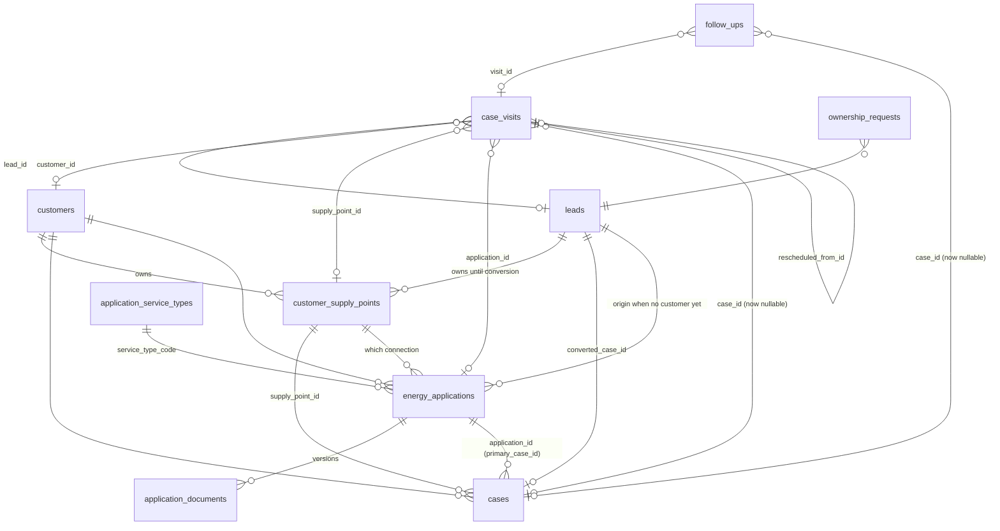

# Field Visits and Energy Applications: architecture

**Status:** design + staged SQL + tests + UI in branch `feat/atlas-field-visits-applications`. **Live reconciliation: pending.** The live Supabase schema could not be read from the tooling (the connector refuses `execute_sql` / `list_migrations`), so everything below is derived from the repository's migrations and the staged files. [`docs/ops/FIELD_APPLICATIONS_LIVE_CHECK.sql`](../ops/FIELD_APPLICATIONS_LIVE_CHECK.sql) is the read-only script the owner runs to close that gap. Nothing here has been applied to any database, and nothing is "verified in Production".

## 1. The journey, and which entity owns each step

```
Prospect ─▶ Lead ─▶ Field Visit ─▶ Customer ─▶ Supply Point ─▶ Application ─▶ Documents ─▶ Case ─▶ Back Office ─▶ Follow-up ─▶ Completion
 (visit.prospect)  (leads)   (case_visits)  (customers) (customer_supply_points) (energy_applications) (application_documents) (cases)
```

| Entity | Table | Purpose | Lifecycle owner |
|---|---|---|---|
| Customer | `customers` (existing) | a real person or business | created only by lead conversion or an explicit, de-duplicated action |
| Lead | `leads` (existing) | a prospect who is not yet a customer | unchanged |
| Supply Point | `customer_supply_points` (existing, phase5/17+18) | one electricity connection of a customer **or** a lead | unchanged, reused |
| **Field Visit** | `case_visits` (**extended**) | a visit, with or without a Case | new standalone lifecycle |
| **Application** | `energy_applications` (**new**) | a request to start one energy service on one supply point | new lifecycle |
| Application document | `application_documents` (**new**) | versioned files of an application | new |
| Case | `cases` (existing) | the Back Office work item | unchanged workflow; gains `application_id` |

`contact_service_requests` (privacy/contact requests) is **not** touched or reused.

### Names that already exist and must not be confused
- Case stage **`application`** («Αίτηση») is a stage of the Case workflow. It stays exactly as it is.
- `cases.application_status` is an existing free-text column. It is not read or written by the new entity.
- Permission **`create_application`** is admin-only today (it guards the Back Office stage tools). **Sales Agent drafts do not use it.** They are guarded by ownership of the application's customer or lead instead; the new entity has its own policy.
- UI label: the new entity is «Αίτηση ενεργειακής υπηρεσίας», the stage stays «Αίτηση». Screens never show a bare "Application".

## 2. Field Visits: extend `case_visits`, do not add a second visit table

**Decision.** Extend `case_visits`. A second table (`field_visits`) would duplicate visits, force every consumer (My Day, Map, dashboards, `field_sales_metrics`, the check-in review) to merge two sources, and split history. Extension keeps every historical row, id and RPC valid.

Changes (staged `phase7/01_standalone_field_visits.sql`, additive, `NOT VALID` constraints so unknown legacy data can never block the migration):

| Change | Why |
|---|---|
| `case_id` becomes nullable | a visit before any Case |
| `lead_id`, `customer_id`, `supply_point_id` (nullable FKs) | what the visit is about |
| `application_id` (nullable FK, added in `phase7/02`) | visit linked to an Application |
| `prospect jsonb` (`name`, optional `phone`, `address`) | a controlled prospect capture when no Lead exists yet; converting it to a Lead keeps the visit |
| check: `num_nonnulls(case_id, lead_id, customer_id) >= 1 or prospect is not null` | no orphan visits; no fake Case |
| check on `status`: `planned, in_progress, completed, cancelled, no_show` | **only `no_show` is new** |
| `outcome_key`, `outcome_reason`, `status_reason`, `rescheduled_from_id` | structured outcome, cancel/no-show reason, reschedule chain |

**Statuses.** Everything that groups visits (`groupVisits`, dashboards, `field_sales_metrics`) knows `planned / in_progress / completed / cancelled`. A new stored status would silently disappear from My Day, so:
- **Ready to visit** is *derived* (planned + scheduled within the arrival window / near the stored point), never stored.
- **Rescheduled** is a *link*: the old visit becomes `cancelled` with `status_reason = 'rescheduled'`, the new visit points back with `rescheduled_from_id`. History is kept on both rows.
- `no_show` is the only new stored status. `groupVisits` treats it as closed.

**Follow-ups and timeline are case-bound too** (found in review, not in the brief): `follow_ups.case_id` and `timeline_events.case_id` are `NOT NULL`. A "follow-up required" outcome on a visit without a Case needs a follow-up row. So `phase7/01` also makes `follow_ups.case_id` nullable and adds `lead_id`, `customer_id`, `visit_id` (anchor check as above). Existing consumers already read `f.case?.…`; the TypeScript type is widened and every use is guarded. Events of standalone visits are written to `activity_log` against the strongest parent (lead / customer / visit), not to `timeline_events`.

**Check-in / check-out RPCs.** `field_checkin` / `field_checkout` read the Case for coordinates and write `timeline_events(case_id)`. They are replaced (same signatures) by versions that: take the target point from the Case, else the visit's own `location`, else the supply point / lead / customer address; skip the `timeline_events` insert when there is no Case and log to `activity_log` instead; stay **idempotent** (a replayed offline request never creates a second check-in). The behaviour for case-bound visits is exactly that of staged `phase4/10`, so `phase7/01` **requires `phase4/10` to be applied first** and says so with a clear error otherwise.

**Ownership.**
- A Sales Agent's visit has `user_id = auth.uid()` forced by trigger; the lead / customer / case / supply point / application it links to must be the agent's own (`sales_owns_*`).
- Link columns cannot be re-pointed to someone else's record. The one allowed change is `null → owned` (prospect → Lead, Lead → Case after conversion).
- Reassignment (`user_id` change) is Admin-only and is written to the audit log.
- `sales_owns_entity` is extended (all existing branches preserved) with `visit` and `application`, otherwise the restrictive `activity_log` policy would hide new audit rows from the agent who owns them.

**Duplicates.** `field_prospect_matches(name, phone, address)` returns existing leads / customers / supply points that look like the prospect. For records the caller does not own it returns only `{kind, id, owned_by_other: true}`: no name, no phone. Nothing is merged. Taking over another agent's lead goes through `ownership_requests` (agent asks, Admin decides, decision recorded); only leads are covered.

## 3. Application (`energy_applications`)

```
draft ──submit──▶ submitted ──▶ in_review ──▶ completed
  │                  │              │
  │                  └──▶ needs_documents ◀┘      (Back Office asks; agent adds a document version → back to submitted)
  └──▶ cancelled (any state before completed)
```

- **Origin:** an existing Customer **or** an eligible Lead (`num_nonnulls(customer_id, lead_id) >= 1`). A Customer is never created in the wizard on its own; a Lead is converted through the existing `convert_lead_to_case()` at submission (no parallel customer path).
- **Supply Point:** required to submit, optional in a draft. It must belong to the same customer / lead. The 11-digit ΔΕΔΔΗΕ number rules and the duplicate signal are the existing `customer_supply_points` ones (flag, never a block).
- **Service:** `service_type_code` is one of the existing service types (`energy`, `gas`, `solar`, `ev`, `insurance`, `web`; the same list `convert_lead_to_case` and `documents.ts` use) from `application_service_types`, an admin-editable table. **No provider, tariff or price is invented**; provider / program / tariff are free fields filled only when known, stored as text next to nullable ids.
- **Draft:** a real row (status `draft`, `wizard_step`, `service_details`). Closing the browser loses nothing; the wizard reloads the draft. Drafts need no documents.
- **Submit (`submit_energy_application`)**, one transaction: validate → resolve the Customer (lead conversion if needed) → create the Case (stage `new`, like every conversion; **the Case stage workflow is untouched**) with `cases.application_id` and `cases.supply_point_id` → assign the default Back Office assignee (`phase4/12`) → set `submitted_at/by`, `primary_case_id` → audit. If the lead conversion took the *duplicate branch* of `phase5/18` (the supply row stayed on the lead and the case was linked to the customer's existing connection) the application's, the visits' and the documents' `supply_point_id` are **re-pointed** to that connection.
- **Case relation:** one Application → one *primary* Case created at submission. `cases.application_id` is not unique, so a later, separate operational Case (e.g. a re-submission after rejection) can legitimately point to the same Application. A Case is never created for a draft.
- **Missing documents** are a checklist and a warning (`documents.ts`, the existing indicative per-service list), never a block on submit or on any stage move.

## 4. Documents and version history (`application_documents`)

**Decision.** A separate table, same private bucket. Making `case_documents.case_id` nullable would touch the most used table of the CRM, its restrictive policies, `sales_can_read_object` and every consumer; a related table leaves all of that unchanged, and a Case shows its Application's documents through the link.

- Bucket: **`client_documents`** (private; `signedUrl` only). Not `hlektrismos_docs` (older anon policies and `getPublicUrl` use in `EntityDetailWindow`). Object path: `applications/<application_id>/<document_id>-v<n>-<safe name>`.
- Columns: `application_id`, `supply_point_id`, `customer_id` (context), `doc_type` (`documents.ts` keys), `version`, `is_current`, `supersedes_id`, `superseded_at/by`, `storage_path`, `file_name`, `mime_type`, `size`, `status` (`received/verified/rejected`), `uploaded_by`, `verified_by/at`.
- **A replacement never overwrites.** `add_application_document(...)` inserts version *n+1*, flips the previous row to `is_current = false` with `superseded_at/by`, in one statement. A partial unique index allows one current row per `(application_id, doc_type, supply_point_id)`. No delete grant.
- **Storage policy (the blocker found in review).** Staged `phase4/21` gates `client_documents` objects by `case_documents.file_url` and lets agents write only under `cases/`. A new table's files would be unreadable (or, if someone loosened it, exposed). `phase7/02` therefore **extends** `sales_can_read_object` / `sales_can_write_object` with an `application_documents` branch (read: the object is one of an application the agent owns; write: path `applications/<uuid>/…` for an application the agent owns), preserving every existing branch. Existing policies are not dropped or weakened.
- Verifying a document stays Admin-only (`verify_document`).

## 5. Customer 360, Back Office, map and offline

- **Customer 360:** the existing `CustomerDetail` gains *Αιτήσεις* and *Επισκέψεις* sections (per supply point); documents and cases keep their `supply_point_id`, so nothing from different supplies is mixed.
- **Back Office:** the existing Διεκπεραίωση page gains a queue «Αιτήσεις & επισκέψεις»: submitted / incomplete applications, missing documents, ownership requests, manager follow-ups, visits needing attention. The Case workflow below is unchanged.
- **Access model:** exactly two roles. The shared Admin / Back Office login cannot identify the individual employee; audit rows record `actor_id` of the shared profile and the UI never claims personal attribution.
- **Offline:** the existing queue (check-in, check-out, photo, note) is reused; replays are idempotent server-side. Prospect names, phones and documents are **never** queued locally; creating a prospect needs a connection.
- **Production safety:** merging ships code, not SQL. Every read of a new column or table is behind an availability probe (as `stageSetAvailable`), so My Day, the Map and Customer pages behave exactly as today until the owner applies the staged files.

## 6. ERD



## 7. Files

| File | Purpose |
|---|---|
| `supabase/staged-migrations/phase7/01_standalone_field_visits.sql` | visits, follow-ups, check-in RPCs, ownership helpers, duplicate signal, ownership requests |
| `supabase/staged-migrations/phase7/02_energy_applications.sql` | applications, service types, documents + versions, storage helpers, submit RPC |
| `docs/ops/rollback_phase7_*.sql` | additive rollbacks |
| `supabase/tests/field-visits-applications.test.mjs` | PGlite gate: the whole chain + phase7, four identities |
| `docs/ops/APPLY_ORDER.md`, `pending_migrations_check.sql` | steps 30–31 and probes |
| `docs/ops/FIELD_APPLICATIONS_LIVE_CHECK.sql` | read-only introspection for the owner |

## 8. Honest limits (also in the PR)
- Live schema not read: constraints, policies and the applied-migration list are unverified; the owner runs the check script.
- `client_documents` bucket settings (MIME, size) are dashboard-defined, not in the repo: unverified.
- Only leads are covered by ownership requests (a customer's owner is derived from its cases).
- All SQL is tested on embedded Postgres (PGlite) with stand-ins for Auth, Storage and PostgREST, never on a real Supabase project and never on Production.
